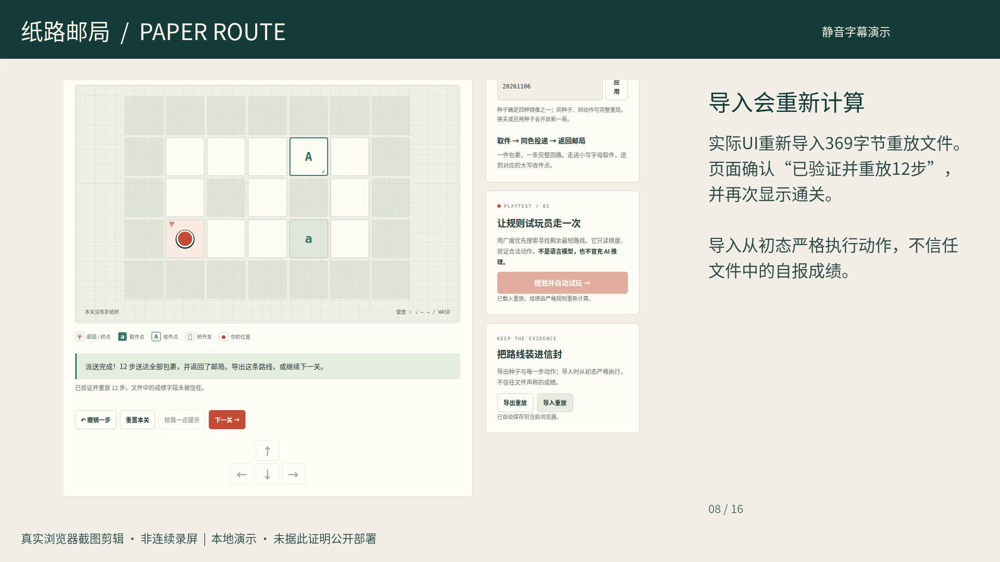

# 纸路邮局 · Paper Route

一款原创的纸上物流路线解谜游戏：背包只能放一件，必须送到对应门牌，在步数用完前返回邮局。四个手工关卡逐步引入取送顺序、单件容量和切换式折纸桥。种子只决定四种镜像变体，不声称生成无限关卡。

另有两种可检查的试玩能力：规则规划器从当前状态搜索剩余最短路线；缺陷实验室在隔离的人工注入变异体中寻找「送错门牌」反例，并与正式严格规则逐步比较。这些功能都是确定性规则搜索，**没有运行时大模型，也不冒充 AI 推理或 DGX Spark Agent**。

## 本地运行

需要 Node.js 20+（测试/构建）及 Python 3（本地静态服务），无 npm 运行时依赖，无需安装框架。

```sh
npm run verify
npm run dev
```

打开 `http://localhost:5173`。这是 ES module 静态应用，请通过 HTTP 服务打开，直接双击 `file://` 可能被浏览器的模块策略阻止。页面、字体、图形和计算均在本地，无远程资源、遥测或网络 API。已加载页面可断网继续玩。

## 操作

- 方向键、WASD、屏幕方向按钮，或点击派送员相邻格子。
- 进入小写 a/b 取件；进入对应大写 A/B 收件点交付。口袋满时不取第二件，错误门牌不收货。
- 进入开关切换所有桥；关闭的桥不能进入。
- 全部送达并返回邮局获胜；最后一步正好用完预算也可获胜。预算耗尽且未完成则失败。
- 撤销会回到上一状态；重置保留当前关卡与种子。提示免费，不执行动作。
- 自动试玩可暂停；手动操作、换关、重置、撤销、打开帮助、页面进入后台都会停止原来的计时器。

## 重放、恢复与缺陷报告

浏览器 `localStorage` 保存的是版本、关卡、种子与动作记录；恢复时从初态重新执行。损坏数据清除后允许正常再保存；禁用存储或配额不足时降级为内存运行。没有云端账户、排行榜、跨设备同步或反作弊承诺。

导出的重放 JSON 可再次导入。导入最多 100 KB、2000 动作，拒绝非法动作、穿墙、未知关卡、未知版本及终局后继续移动；成绩字段被忽略，结果由正式规则计算。导入失败保留当前游戏。

缺陷实验会寻找最短触发路径，提供种子、初态、完整动作、预期/实际状态与失败不变量。人工注入的演示变异体故意取消门牌匹配；正式游戏始终使用严格规则。缺陷报告不是普通重放文件；可按报告在代码里分别执行：

```js
import { replay } from "./engine.js";
const data = { ...report.initial, actions: report.actions };
const expected = replay(data);
const actual = replay(data, { mutant: true });
```

## 发布产物

`npm run build` 生成 `dist/`，入口 `dist/index.html`，全部资源使用相对路径。静态预览服务指向 `dist/` 即可。魔搭创空间官方部署参考明确支持预构建 Static 项目；上传时应将 **dist 内容**放到空间根目录，而不是上传 dist 父目录。见 [部署说明](docs/deployment.md)。

## 赛事状态与真实使用披露

本项目为 AI+∞ 第三期「AI 造游戏」的 **AI 游戏作品**方向准备，未正式报名或提交。Codex 协助产品设计、代码、关卡、测试与文档；Qoder、魔搭模型调用和 DGX Spark 未使用。游戏运行不依赖模型。代码和关卡为本次独立创作，没有从已有 PlayLab 游戏复制。

公开构想帖、报名审核、魔搭账号条款确认及创空间公开部署、创作手记发布和最终作品提交仍未完成。158秒本地演示视频已完成并通过检查，见下方材料。本地真实浏览器验证已另行完成，不能替代这些平台阶段。私有预览或 GitHub 推送不等于赛事提交。不要编造工具使用截图、运行记录、用户结果或平台部署证据。[赛事要求与未完成事项](docs/competition.md)。

## 验证与源码

`npm test` 覆盖四关×四种镜像可解、容量/门牌/桥规则、预算与终局、撤销、种子边界、严格重放、防伪成绩、规划器预算和搜索上限、缺陷报告可重现。`npm run check` 检查语法、DOM 引用和默认运行时无网络依赖；`npm run build` 只复制明确允许的静态产物。2026年11月10日主智能体已通过实际本地浏览器操作核验：第一关右移/撤销/不执行动作的提示、12步自动试玩通关、实际JSON导出/重置/重新导入；第三关两步打开桥并刷新恢复；隔离错误门牌变异体0/3/4步对照与报告导出。见[本次浏览器证据](docs/evidence/browser-verification-20261110.json)及[说明](docs/evidence/README.md#2026年11月10日另行完成的实际浏览器核验)。本轮不是四关或移动端全量浏览器测试；15张静态截图已剪成明确标注的本地演示，不能称为连续录屏。单元测试不替代浏览器 QA。

- `engine.js`：原创状态转换、重放、BFS 规划、演示缺陷搜索。
- `app.js`：页面交互、浏览器恢复、计时器、报告导出。
- `docs/landscape.md`：两个相近开源起点、许可、差距和独立实现边界。
- `docs/ai-development.md`：可据实补充的创作过程记录。

MIT 许可。没有捆绑第三方运行时代码、图片、音频或字体；参考项目不是代码依赖。

Local preview serves only the built `dist/` on `127.0.0.1:5173`; run `npm run build` first and rebuild after source changes.


## 实际演示材料

[158秒本地演示MP4](docs/media/paper-route-local-demo.mp4)与[媒体验收记录](docs/evidence/local-demo-20261110.json)已备好。影片为真实浏览器操作后的截图剪辑，中文静音说明，无旁白；覆盖撤销、提示、12步通关、严格导入、故意缺陷对照、桥开关与刷新恢复。视频和脱敏画面不证明魔搭已部署或参赛成功。


